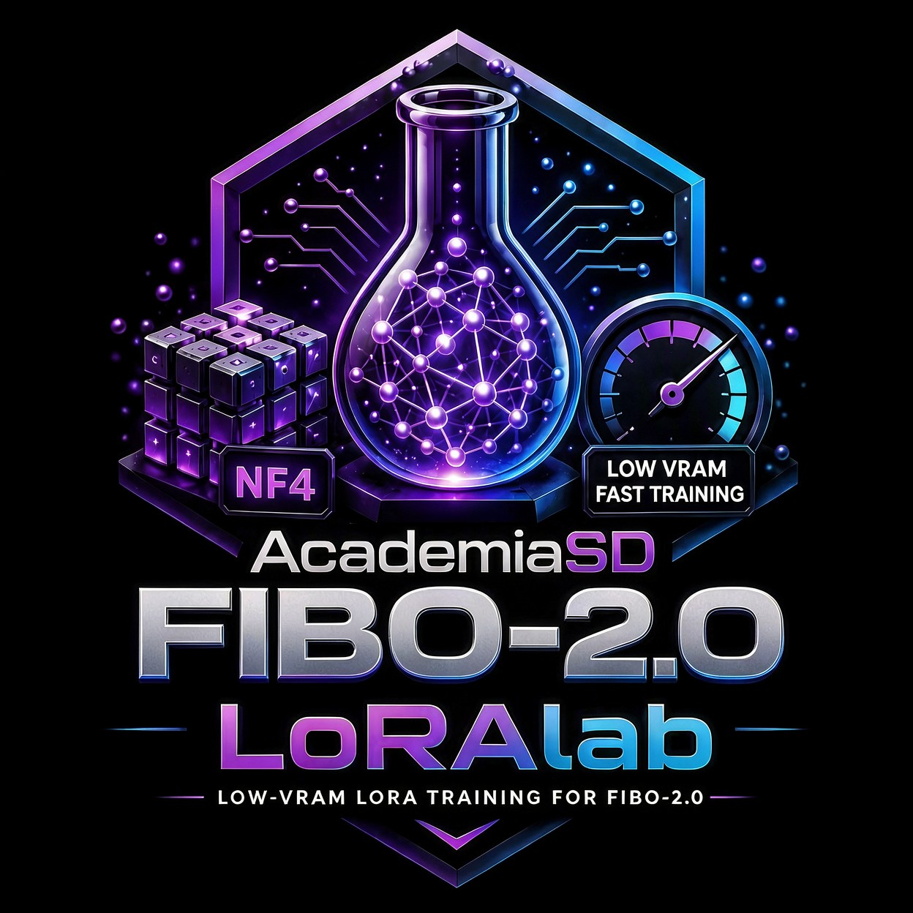

> **Technical notes** for the Fibo 2.0 trainer of **AcademiaSD LoRAlab Trainer Studio**. Installation, updating and everyday use are in the [main README](../README.md).

# Fibo 2.0 trainer — technical notes



<p align="center">
  <b>A fast, low-resource Web GUI & pipeline for training BRIA Fibo 2.0 (NF4) LoRAs: characters, objects, styles and edits.</b>
</p>

<p align="center">
  
  
  
  
</p>

All measurements below were taken on an **RTX 5080 (16 GB)**.

---

## ✨ Features

### Training
| Feature | Status |
| :--- | :--- |
| Character / object / style LoRAs (image + caption) | ✅ Verified — 512² and 1024², rank 8/alpha 8, LR 1e-4: the loss falls and the previews follow the caption |
| LoRA Type selector in Pre-Cache: **Normal** (image + caption) or **Edit** (`name_before` / `name_after` pairs + instruction) | ✅ Verified |
| Edit LoRAs (`name_before` / `name_after` pairs + instruction) | ✅ Verified — the before image conditions the generation as context tokens and the loss is computed only on the "after" |
| NF4 transformer (8.1 B) | ✅ Verified — loads in 3.3 s, 5.2 GB VRAM; the NF4 cache rebuilds the model **bit-exactly** (round trip error 0.0) |
| LoRA Targets: All (415 linear layers, BRIA's recipe) / Blocks (attention + MLP of the 44 blocks) | ✅ Verified |
| FP32 LoRA + AdamW, gradient checkpointing, cosine LR with warmup | ✅ Verified |
| Exact-step resume (uses the checkpoint's layers, rank and alpha) | ✅ Verified |
| Live settings while training (steps, save/preview every, preview settings, caption mode, fast previews, LR) | ✅ Verified |
| Live **custom preview prompt** and edit preview image (encoded on CPU while training, on GPU otherwise) | ✅ Verified |

### Previews
| Feature | Status |
| :--- | :--- |
| Normal previews (default 30 steps, CFG 5 — the model's own defaults) | ✅ Verified |
| Preview Size (Training / 768 / 1024) | ✅ Verified — a 512² training with Preview Size 768 gives a 768×768 preview |
| Edit previews on a user image outside the dataset | ✅ Verified |
| **Fast Previews** (fewer steps, no guidance) | ✅ Verified — Fibo 2.0 Dev has no distilled LoRA, so the switch only cuts the steps and the CFG |

### Pre-cache & text encoder
| Feature | Status |
| :--- | :--- |
| Text encoder Qwen3-VL-4B (the model's own): **NF4 (default, 2.7 GB)**, INT8, BF16, BF16 CPU offload | ✅ Verified |
| VAE latents normalised with the VAE's own BatchNorm statistics, in the model's trained sizes | ✅ Verified |
| Structured JSON captions (`<name>.json`) are preferred over plain text (`<name>.txt`); the Dataset Manager shows and edits the one that is there | ✅ Verified |
| `text_render` entries: the text is drawn and shown to the model, and the caption goes in without the drawings above the noise level 0.9 | ✅ Verified — a caption with `HELLO WORLD` renders it |
| Re-running pre-cache skips latents already cached | ✅ Verified |

### Dataset tools
| Feature | Status |
| :--- | :--- |
| Auto-captioner with Qwen3-VL-4B (the model's own text encoder, NF4): **Normal** and **Edit** modes | ✅ Verified |
| Dataset Manager: search, grid sizes, resizable grid, per-image delete, common text (append / replace / remove), clear captions | ✅ Verified (server) |
| Delete Pre-Cache / Delete Training buttons | ✅ Verified (server) |

### Export
| Feature | Status |
| :--- | :--- |
| LoRA in the format ComfyUI's loader takes (`diffusion_model.<capa>.lora_A/lora_B` + `alpha`): the layers that ComfyUI fuses (attention qkv, MLP w13, cross-attention to_kv) are rewritten as one LoRA of several times the rank, and the applied change is exactly the same | ✅ Verified against the user's ComfyUI model: all 266 layers found, no shape mismatches, identical delta |
| Metadata tags (`ss_*` kohya convention, trigger word for CivitAI) | ✅ Verified |
| Converting a LoRA trained with the old `transformer.*` keys, without retraining: `tools/fibo2/7_conversor_lora_comfyui.py` | ✅ Verified — 266/266 layers found by ComfyUI and the same delta |
| One-click "Send to Models" | ✅ Verified |

---

## 🔬 How it works

- **Two stages.** `1_pre_cache` encodes every caption with Qwen3-VL-4B and every image with the VAE once. `2_train_lora` never loads the text encoder or the VAE for training: 100 % of the GPU goes to the transformer.
- **NF4 transformer, rebuilt directly.** The attention, MLP and cross-attention of the 44 blocks and of the 2 refiner blocks are NF4 (342 layers); the perceptor that turns the caption into *gist* tokens, the adaLN modulation of every block and the input/output layers stay in BF16 (73 layers), because quantizing them puts noise in the text path. The model is built empty and filled from the NF4 cache, with no BF16 copy.
- **Exact conditioning.** The caption is encoded exactly as the official `BriaFibo2Pipeline` does: the same prompt cleaning, the same compact serialisation, the same six bundles of features (the perceiver's and one per injection block) and the same mask semantics. The cached mask has one entry per token.
- **Flow matching.** `x_t = sigma · noise + (1 - sigma) · x0`, target `noise - x0`, MSE in float32. The noise level follows BRIA's recipe: 90 % logit-normal with the mean that depends on the size of the image, 10 % uniform.
- **Edit LoRAs.** The "before" image goes through Qwen3-VL together with the instruction and, as a clean latent, conditions the generation as context tokens; the loss is computed only on the "after". 10 % of the samples drop the caption (text dropout) and 20 % drop the context latent (context dropout), as in the reference trainer.

---

## 🔧 The NF4 conversion

The NF4 build is downloaded from `AcademiaSD/Fibo-2.0-NF4-for-LoRA-Training` the first
time it is needed. To build it yourself, `tools/fibo2/5_conversor_Fibo2_NF4.py` is run **once**:

```
Fibo2_Dev-Raw/        (the diffusers folder of briaai/Fibo-2.0-dev)
Fibo2_Dev-NF4/        (what it writes)
    transformer/        NF4 cache: config.json, index.json, weights/, others.safetensors
    text_encoder_BF16/  Qwen3-VL-4B in BF16 (8.5 GB)
    text_encoder_INT8/  Qwen3-VL-4B in INT8 (4.6 GB)
    text_encoder_NF4/   Qwen3-VL-4B in NF4  (2.7 GB)  also the captioner
    vae/ scheduler/ processor/ fonts/ ...
```

The conversion needs diffusers with `BriaFibo2Transformer2DModel` (merged upstream in `huggingface/diffusers#14991`): run **`Update_LoRAlab-TrainerStudio.bat`** first.

---

## 🖥️ System Requirements

| Requirement | Tested | Notes |
| :--- | :--- | :--- |
| **OS** | Windows 11 | Linux has the same `.sh` entry point |
| **GPU** | NVIDIA, **10 GB VRAM minimum** ✅ verified (512²) | Developed on an RTX 5080 16 GB. 1024² needs 12 GB; **edit** at 1024² needs 16 GB, because the before image adds its tokens to the sequence |
| **RAM** | **16 GB minimum** (measured) | The NF4 conversion loads the 15.5 GB BF16 transformer in RAM: 32 GB recommended |
| **Python** | 3.13 (inside `venv`) | Installed automatically if missing |

---

## 💬 Community & Support

- ▶ **YouTube**: [youtube.com/@Academia_SD](https://www.youtube.com/@Academia_SD)
- 𝕏 **X (Twitter)**: [twitter.com/Academia_S_D](https://twitter.com/Academia_S_D)
- 💬 **Discord**: [discord.gg/Syuaduy678](https://discord.gg/Syuaduy678)
- ☕ **Ko-Fi**: [ko-fi.com/academiasd](https://ko-fi.com/academiasd)

---

## 📜 Credits & License

Developed with ❤️ by **AcademiaSD**. Built upon PyTorch, Diffusers, Transformers, PEFT, Bitsandbytes and Hugging Face Hub.

The code is MIT licensed. The **Fibo 2.0 weights are under a CC BY-NC 4.0 licence: non-commercial use only** (commercial use needs a separate agreement with BRIA). Check its terms before sharing trained LoRAs.
